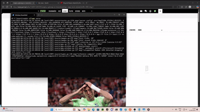

# ai4u-browser-extension

Ai4u Browser extension that enables communication between your web browser and local Ollama server.


Demo of functionality:



## Features

- **Dynamic Prompt Execution**: Execute any prompt against the content of the current web page.
- **Customizable Prompts**: Create, save, and manage your own prompts. Use `{{pageText}}` as a placeholder for the page content.
- **Flexible Model Selection**: Easily switch between different Ollama models.
- **Tabbed Interface**: A clean, two-tab layout for "Prompt Executor" and "Settings".
- **Local Storage**: Your custom prompts and model settings are saved locally for convenience.
- **Modern UI**: A refreshed and intuitive user interface.

## Prerequisites

1. **Ollama Installation**
   - Download and install Ollama from [ollama.ai](https://ollama.ai)
   - Follow the installation instructions for your operating system
   - Ensure Ollama is running in the background

2. **CORS Configuration**
   - Ollama needs to be configured to accept requests from your browser extension
   - Set the following environment variable before starting Ollama:
   ```bash
   # Windows (PowerShell)
   $env:OLLAMA_ORIGINS="chrome-extension://*"

   # Windows (Command Prompt)
   set OLLAMA_ORIGINS=chrome-extension://*

   # Linux/macOS
   export OLLAMA_ORIGINS="chrome-extension://*"
   ```
   - Restart Ollama after setting the environment variable
   - Note: The `chrome-extension://*` wildcard allows all Chrome/Edge extensions to connect. For better security, you can specify your extension's ID instead.

3. **Token Limit Configuration (Optional)**
   - By default, Ollama uses a 4096 token limit
   - To change this limit, set the `OLLAMA_NUM_CTX` environment variable:
   ```bash
   # Windows (PowerShell)
   $env:OLLAMA_NUM_CTX="8192"  # or your desired token limit
   # Verify the setting
   echo $env:OLLAMA_NUM_CTX

   # Windows (Command Prompt)
   set OLLAMA_NUM_CTX=8192
   # Verify the setting
   echo %OLLAMA_NUM_CTX%

   # Linux/macOS
   export OLLAMA_NUM_CTX=8192
   # Verify the setting
   echo $OLLAMA_NUM_CTX
   ```
   - **Important**: After setting the environment variable:
     1. Completely stop the Ollama service
     2. Start Ollama again
     3. Verify the setting is active by checking Ollama logs
   - If you still see truncation to 4096 tokens:
     - Make sure you're running Ollama in the same terminal session where you set the environment variable
     - Or set the environment variable system-wide:
       ```bash
       # Windows (System Properties -> Environment Variables)
       # Add OLLAMA_NUM_CTX=8192 to System Variables
       
       # Linux/macOS (add to ~/.bashrc or ~/.zshrc)
       echo 'export OLLAMA_NUM_CTX=8192' >> ~/.bashrc
       source ~/.bashrc
       ```
   - Note: Higher token limits require more memory. Adjust based on your system's capabilities.
   - If you see messages like `"truncating input prompt"` in Ollama logs, it means your input exceeds the token limit. In this case:
     - Either increase the `OLLAMA_NUM_CTX` value
     - Or reduce the size of your input prompt
     - The log will show the actual token count (e.g., `prompt=6681`) to help you determine the appropriate limit

4. **Gemma 3 Model**
   - After installing Ollama, pull the Gemma 3 model by running:
   ```bash
   ollama pull gemma3:latest
   ```
   - Verify the model is installed by running:
   ```bash
   ollama list
   ```

## Browser Extension Installation

### Chrome/Edge Installation

1. **Download the Extension**
   - Clone this repository or download the latest release
   - Extract the files to a local directory

2. **Load the Extension**
   - Open Chrome/Edge and navigate to `chrome://extensions/` or `edge://extensions/`
   - Enable "Developer mode" in the top right corner
   - Click "Load unpacked"
   - Select the directory containing the extension files

3. **Verify Installation**
   - The extension icon should appear in your browser's toolbar
   - Click the icon to ensure it's properly connected to your local Ollama server

## Usage

The extension is designed to be simple and intuitive.

### Prompt Executor Tab
1.  Navigate to the web page you want to process.
2.  Click the extension icon in your browser toolbar.
3.  The **Prompt Executor** tab will be active by default.
4.  Click **"Execute Prompt"**.
5.  The extension will grab the text content from the page, insert it into your configured prompt (replacing `{{pageText}}`), and send it to your local Ollama server with the selected model.
6.  The response from Ollama will be displayed in the result area.

### Settings Tab
This tab allows you to customize the extension's behavior.

1.  **Custom Prompt**:
    -   Modify the prompt in the textarea. Remember to include `{{pageText}}` where you want the page's content to be inserted.
    -   Click **"Restore Default"** to revert to the original prompt.
2.  **Model Settings**:
    -   Enter the name of the Ollama model you want to use (e.g., `gemma3:latest`, `llama3:8b`).
3.  **Save**:
    -   Click **"Save Settings"** to store your custom prompt and model name. These settings will be remembered for future use.

### Keyboard Shortcut
- Press `Alt+Shift+S` (Windows/Linux) or `Option+Shift+S` (macOS) to quickly open the extension popup.

## Troubleshooting

- Ensure Ollama is running in the background
- Verify the Gemma 3 model is properly installed
- Check that the extension has necessary permissions
- If connection issues persist, try restarting both Ollama and your browser

## Support

For issues and feature requests, please create an issue in the repository.

## License

MIT 
Radek Szpila
